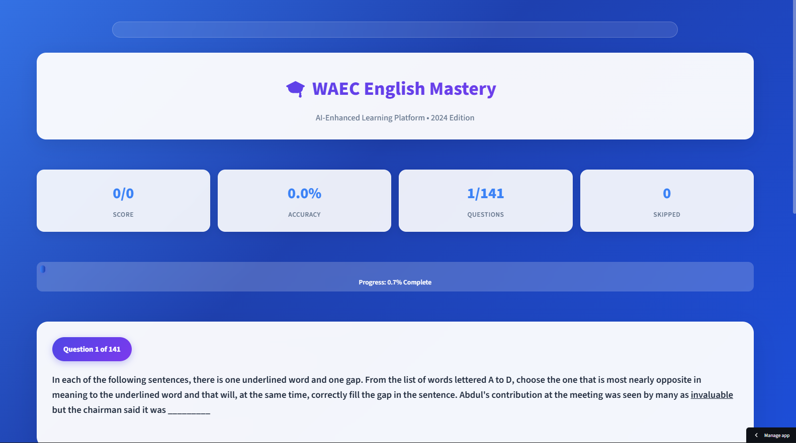

# WAEC English Mastery

[](https://waecdemoapp.streamlit.app/) [](https://xyrusportfolio.netlify.app/)

> A Streamlit-based WAEC English question-practice application using structured year-specific CSV datasets, session-level quiz state and optional AI explanations with audio.

**Live demo:** https://waecdemoapp.streamlit.app/  
**Project documentation and source:** https://github.com/ebukaxyrus/waecdemoapp  
**Maintainer:** Dimakunne Chukwuebuka Francis

## At a glance

| Area | Details |
| --- | --- |
| Category | Exam Preparation / EdTech |
| Application framework | Streamlit |
| Entry point | `check3.py` |
| Deployment | [Open live application](https://waecdemoapp.streamlit.app/) |

## Application preview

[**Launch the live interactive application**](https://waecdemoapp.streamlit.app/) to view its actual interface.



## The problem and approach

A Streamlit-based WAEC English question-practice application using structured year-specific CSV datasets, session-level quiz state and optional AI explanations with audio.

The app reads its question records from local CSV datasets. Streamlit session state tracks the current question, answers, score, selected year and explanation cache. Additional explanation generation depends on the configured OpenAI API client. Quiz outcome metrics are based on the app's answer data; they are **not** an independent measure of learning effectiveness.

## Features

- Load WAEC English question CSV files across the years included in this repository (2015–2024).
- Navigate questions with answer choices and progress tracking.
- Track submitted, attempted and skipped questions in Streamlit session state.
- Calculate score, attempted-question accuracy and an end-of-quiz summary.
- Provide an option to download quiz results as CSV.
- Include an OpenAI-based explanation integration when configured and generate audio from explanations where available.

## Technology stack

- Python
- Streamlit
- Pandas
- OpenAI Python SDK
- gTTS

## Repository structure

- `check3.py` — application UI, dataset loading, quiz state, result export and optional explanation functions.
- `waec_english_2015_complete.csv` through `waec_english_2024_complete.csv` — structured question data.
- `requirements.txt` — Python dependencies.

## Run locally

Prerequisites: Python 3.10+ is a reasonable starting environment, but no fixed compatibility matrix has been independently tested. Check the dependency versions actually available for your environment.

```bash
git clone https://github.com/ebukaxyrus/waecdemoapp.git
cd waecdemoapp
python -m venv .venv
```

Activate the environment:

```bash
# macOS or Linux
source .venv/bin/activate
# Windows PowerShell
# .venv\\Scripts\\Activate.ps1
```

Install packages and start the app:

```bash
python -m pip install -r requirements.txt
streamlit run check3.py
```

For optional AI explanation functionality, configure the OpenAI credentials expected by the code. Keep keys in environment variables or Streamlit secrets, never GitHub source. Audio may require network access.

## How to use

1. Start the app and select an available examination year.
2. Read the question and choose an answer or skip when offered.
3. Submit answers and navigate through the set.
4. Review the performance summary and download available results.
5. Use explanation/audio tools only when the required API integration is configured.

## Limitations and responsible use

- Question text and answers should be checked against original examination papers; do not assume a dataset is error-free.
- Confirm legal permission to publicly redistribute examination materials.
- AI explanations require a valid supported API configuration and can be imperfect.
- Generated audio availability depends on runtime connectivity and configuration.
- Do not describe the app as an official WAEC service or claim official affiliation.

## Quality and future improvements

- [ ] Test a clean installation and pin compatible dependency versions.
- [ ] Add real screenshots, alt text and demonstration media.
- [ ] Add automated tests for primary use cases and invalid input.
- [ ] Review accessibility, error handling and mobile usability.
- [ ] Verify datasets, licenses, user privacy, and live deployment behavior.

## Maintainer and links

**Dimakunne Chukwuebuka Francis**  
Head of Data & Artificial Intelligence, Schoolville ICT Hub  
Founder, XY AI Solution

- [Professional portfolio](https://xyrusportfolio.netlify.app/)
- [GitHub profile](https://github.com/ebukaxyrus)
- [XY AI Solution](https://xyaisolution.online/)

**Documentation scope:** Written from repository source inspection; successful clean-environment installation and end-to-end live application behavior have not been independently verified.
